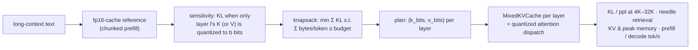
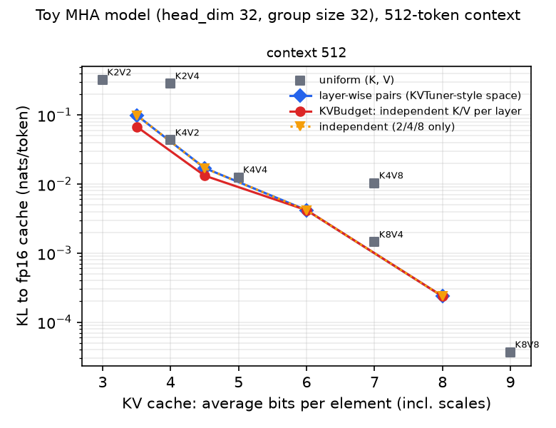
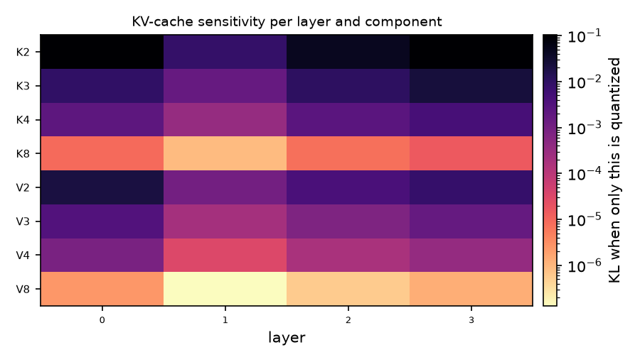
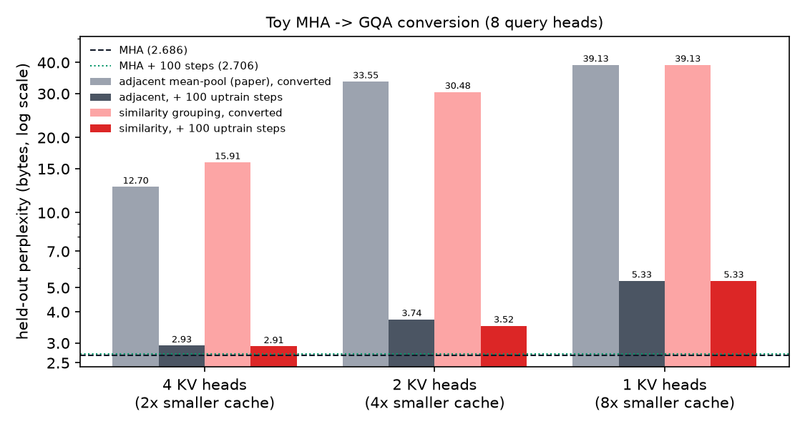

# KVBudget

**Memory-budgeted mixed-precision KV cache for long-context on-device LLMs (MLX).**

During decoding, a transformer keeps the keys and values of every past token in every layer: the KV cache. On a phone or laptop with fixed unified memory, the cache decides how long a conversation or document the model can hold. Quantizing the cache shrinks it, but mlx-lm offers only one bit-width for keys *and* values across *every* layer.

KVBudget gives each layer its own key and value precision, chosen under a fixed memory budget, and measures what that buys on Apple silicon:

* **A runtime:** a drop-in `MixedKVCache` for mlx-lm with independent `k_bits`/`v_bits` per layer (2/3/4/8/16). Storage is truly quantized, attention runs on it with `mx.quantized_matmul`, and caches support trimming for speculative decoding.
* **An optimizer:** per-layer, per-component sensitivity profiling (KL to the fp16-cache model on long contexts), then an exact knapsack allocation under an average-bits budget.
* **A long-context benchmark:** KL and perplexity at 4K–32K, needle-in-a-haystack retrieval, KV and peak memory, and prefill and decode tokens/sec.
* **Track C (toy scale):** the GQA paper's MHA→GQA conversion with mean-pooling vs. similarity-based head grouping, with and without uptraining.

```bash
kvbudget profile  --model qwen-1.5b-8bit --seq-len 4096 --out sens.json
kvbudget allocate --sens sens.json --avg-bits 3.5 --out plan.json        # K/V bits per layer
kvbudget eval     --model qwen-1.5b-8bit --plan plan.json --uniform 4,4 16,16 --seq-lens 4096,32768
```

## Positioning: what is and isn't new

Layer-wise mixed-precision KV quantization is **not** a new idea. [KVTuner (ICML 2025)](https://arxiv.org/abs/2502.04420) searches layer-wise key/value precision pairs using sensitivity analysis, and KVmix (AAAI 2026) uses gradient-based layer importance. Apple's own [QuantSpec (ICML 2025)](https://arxiv.org/abs/2502.10424) uses a hierarchical quantized KV cache for self-speculative decoding.

KVBudget's contribution is a **systems** one:

1. **An MLX implementation** that mlx-lm lacks: independent K/V bits per layer, real quantized storage, and attention dispatch for any Llama-family mlx-lm model, with no forked model code.
2. **A same-machinery comparison** on identical sensitivity estimates:
   - *uniform* (mlx-lm today);
   - *layer-wise (K, V) pairs* from a fixed list, i.e. the KVTuner-style search space (the space, not KVTuner's search algorithm);
   - *independent K and V per layer*.
3. **Apple-silicon measurements** of whether the memory savings survive contact with the hardware. mlx-lm's quantized attention, and therefore KVBudget's, is two `quantized_matmul` calls with the full score matrix in between, not a fused flash-style kernel. **Fewer cache bits can mean slower decoding**, and where that crossover sits is one of the questions the benchmark answers.

## How it works



* **Cache.** Each layer gets either mlx-lm's dense `KVCache` (for 16/16 layers, keeping the fused attention kernel) or a `MixedKVCache` holding keys and values as MLX affine `(packed, scales, biases)` triplets at their own bit-widths. Every token is quantized as it is written, during prefill and decode alike. mlx-lm model files import `scaled_dot_product_attention` into their own namespace, so `kvbudget.cache.install(model)` routes `MixedKVCache` layers to `mixed_sdpa` and leaves everything else untouched.
* **Profiling.** Sequences are prefilled in 512-token chunks, so later chunks attend to the quantized cache of earlier ones. Quality is the KL divergence of next-token distributions from the fp16-cache model at positions with at least 512 tokens of context. Profiling uses a dense fake-quant cache that is numerically identical to the real one (tested), so no kernel effects leak in.
* **Allocation.** Each (layer, K or V) item picks a bit-width; its cost is the exact bytes per token, including scale and bias metadata. Budgets are average effective bits per cached element: uniform 4-bit at group size 64 is 4.5 and fp16 is 16. Byte costs are integers, so the knapsack DP is solved exactly on the gcd grid.

### Track C: MHA → GQA conversion

[GQA (Ainslie et al., EMNLP 2023)](https://arxiv.org/abs/2305.13245) converts a multi-head checkpoint by mean-pooling each group's key and value heads (the paper groups *adjacent* heads), then uptrains for about 5% of the original compute.

Replacing a group's heads by their mean costs exactly the within-group spread of those heads' K/V activations. KVBudget therefore also tries **similarity grouping**, a balanced clustering that minimizes that spread, solved greedily and refined by swaps. Query heads are then permuted so each group's heads are contiguous; this reorders `q_proj` rows and `o_proj` columns without changing the function (tested).

Modern models (Llama 3, Qwen2.5) already ship as GQA. Qwen2.5-1.5B has 12 query heads but only 2 KV heads, so this track runs on a toy MHA model rather than a real one.

## Results

### Toy-scale validation (measured here; hardware-independent quality numbers)

The model is a 3.0M-parameter byte-level Llama with **8 query heads and 8 KV heads** (MHA), head_dim 32, 4 layers, and 512-token context. It was trained on Python standard-library source with a deterministic held-out split. Training used JAX ([`examples/toy_common.py`](examples/toy_common.py); the JAX model matches mlx-lm's Llama to 1e-6), because MLX's Linux CPU backend has no BLAS. Everything else runs through the same MLX code as real models. Reproduce with `./scripts/run_toy.sh`.

#### Track A: KV-cache budgets

KL is measured against the fp16-cache model on held-out text, at positions with ≥128 tokens of context. With head_dim 32 the quantization group is 32, so metadata costs 1 bit per element: uniform 4-bit is 5.0 bits here, not 4.5.

| avg bits / element | uniform (K, V) | layer-wise pairs | **KVBudget independent K/V** |
|---|---|---|---|
| 3.0 | K2V2: 0.324 | – | – |
| 3.5 | – | 0.0993 | **0.0679** (−32%) |
| 4.0 | K4V2: 0.0433 · K2V4: 0.286 | – | – |
| 4.5 | – | 0.0171 | **0.0132** (−23%) |
| 5.0 | K4V4: 0.0125 | – | – |
| 6.0 | – | 0.00418 | 0.00418 |
| 7.0 | K8V4: 0.00144 · K4V8: 0.0103 | – | – |
| 8.0 | – | 0.00024 | 0.00024 |

<p align="center">
</p>

* **Keys are far more fragile than values.** At the same size, K4V8 has 7× the KL of K8V4, and K2V4 6.6× that of K4V2. This matches KIVI's observation and is exactly what mlx-lm's single `kv_bits` setting cannot express.
* **Per-layer allocation beats uniform.** At 4.5 bits, KVBudget matches uniform K4V4's quality (KL 0.0132 vs 0.0125) with 10% less cache. At 3.5 bits it lands far below the line between the nearest uniform options (K2V2 at 3.0 and K4V2 at 4.0).
* **An honest ablation: the gain over the pair space comes from 3-bit keys, not from decoupling K and V.** Restricted to {2, 4, 8} bits, the independent search returns *exactly* the same plans as the pair space (dotted line), because a good pair list already contains the asymmetric combinations that matter (K4V2, K8V4). Finer granularity is what helps. Whether decoupling matters on 28-layer models is a question for the real sweep.
* **KL vs. perplexity.** At 4.5 bits, perplexity change slightly favours the pair plan (+0.033 vs +0.041) while KL favours independent. KL is the optimized and lower-variance metric (perplexity here is computed over only ~2.3k tokens), but the disagreement is reported rather than hidden.
* **The predicted (additive) KL ranks plans like the measured KL**, which is also tested.

#### Track C: MHA → GQA conversion

| KV heads (cache size) | adjacent mean-pool (paper): converted → +100 steps | similarity grouping: converted → +100 steps |
|---|---|---|
| 8 (MHA baseline) | 2.686 | – |
| 4 (½) | 12.70 → 2.93 | 15.91 → **2.91** |
| 2 (¼) | 33.55 → 3.74 | 30.48 → **3.52** |
| 1 (⅛, MQA) | 39.13 → 5.33 | identical (one group) |

Values are held-out byte perplexity. 100 uptraining steps is 5% of pretraining, matching the paper's recipe. Control: the MHA model given the same 100 extra steps reaches 2.706, so uptraining gains are not just "more training".

<p align="center"></p>

* **Uptraining is not optional.** Conversion alone wrecks the model (perplexity 12–39). 5% uptraining recovers most of it: 4 KV heads ends 8% above MHA (2.91 vs 2.69) with a 2× smaller cache.
* **Similarity grouping helps after uptraining** (2.91 vs 2.93 at 4 heads, 3.52 vs 3.74 at 2 heads, −6%), **but not before it.** At 4 heads, the similarity groups have lower activation spread yet *higher* converted perplexity (15.9 vs 12.7). Activation spread is an imperfect proxy for loss, which is worth knowing before trusting any data-free grouping heuristic.
* These are single runs on a tiny model. Treat sub-5% differences as suggestive, not conclusive.


### Real models on Apple silicon

`scripts/run_sweep.sh` uses Qwen2.5-1.5B-Instruct with 8-bit weights (to isolate the cache and fit a 16 GB Mac). It profiles sensitivity at 4K, allocates at 3.0/3.5/4.5/6.0 average bits in both search spaces, and compares against uniform K16V16, K8V8, K8V4, K4V4, K4V2, and K2V2. It measures KL and perplexity at 4K/16K/32K, needle retrieval at 4K/16K/32K, and memory and speed at 4K–32K. **It has not been run for this release**, because the build machine had no Apple GPU and no Hugging Face access, so the table is deliberately empty.

For scale, Qwen2.5-1.5B's fp16 KV cache is 2 × 28 layers × 2 KV heads × 128 dims × 2 bytes ≈ 28 KB per token. That is about 112 MiB at 4K and about 896 MiB at 32K, comparable to the ~1.6 GB of 8-bit weights. KV budgeting matters at long context, and much less at 4K.

| config | avg bits | KV @32K | KL @32K | needle @32K | decode tok/s @32K |
|---|---|---|---|---|---|
| fp16 cache | 16 | – | 0 | – | – |
| uniform K4V4 (mlx-lm `--kv-bits 4`) | 4.5 | – | – | – | – |
| layer-wise pairs @3.5 | 3.5 | – | – | – | – |
| KVBudget independent @3.5 | 3.5 | – | – | – | – |

## Quickstart (Apple silicon)

```bash
git clone https://github.com/JayaChandraDadi/KVBudget && cd KVBudget
python -m venv .venv && source .venv/bin/activate && pip install -e ".[dev]"
./scripts/run_sweep.sh            # full experiment
```

Python API:

```python
import mlx.core as mx
from mlx_lm import load
from kvbudget import Sensitivity, allocate, make_cache

model, tok = load("qwen-1.5b-8bit")
plan = allocate(Sensitivity.load("sens.json"), avg_bits=3.5)      # [LayerKV(k_bits, v_bits), ...]
cache = make_cache(model, plan)                                    # pass as prompt_cache / cache=
logits = model(mx.array([tok.encode("...")]), cache=cache)
```

The cache list also works as `prompt_cache=` for mlx-lm's `stream_generate` (tested). Caches support `trim`, which speculative decoding needs for rollback.

## Tests

```bash
pytest -q   # 48 tests, CPU-only, no downloads (~1 min)
```

* **Real vs. simulated:** quantized storage plus `mixed_sdpa` computes the same outputs as attending over quantize→dequantize values, across mixed plans, chunked prefill, decode steps, and writes that straddle the 256-token allocation boundary.
* **Agreement with mlx-lm:** with K = V bits, the attention path matches mlx-lm's own `QuantizedKVCache`. An fp16 plan matches the uncached model exactly.
* **Rollback:** after `trim`, decoding reproduces the same logits.
* **Byte accounting:** cache sizes match the closed-form bytes per token exactly.
* **Scoring:** chunk size doesn't change fp16 NLL, the reference scores zero KL against itself, and real and simulated caches score the same.
* **Allocation:** budgets are respected, the independent search is never worse than the pair space at the same bits, more budget never hurts, and predicted error ranks configurations the way measured KL does.
* **GQA:** identity grouping and planted-duplicate heads convert exactly, similarity grouping recovers planted clusters, stays within 10% of brute-force optimum, and never costs more than adjacent grouping.
* **CLI end to end** on a tiny local model.

CI runs the suite on GitHub's Apple silicon runner, so it covers the Metal GPU kernels (including per-kernel real-vs-simulated attention checks).

## Limitations and next steps

* **Unfused quantized attention.** Both mlx-lm's path and KVBudget's materialize the score matrix. A fused Metal kernel that dequantizes K/V tiles on the fly (FlashAttention-style) is what would turn memory savings into speed at long context.
* **Per-token grouping only.** MLX quantizes along the head dimension per token. Keys have outlier *channels* (KIVI's observation), which favours per-channel key quantization, and that needs a different storage layout.
* **Additive errors.** The knapsack assumes per-layer KL adds up. Tests check rankings, and the sweep compares predicted against measured KL.
* **Next (Track B):** an MLX reproduction of QuantSpec's hierarchical KV cache inside [QuantDraft](https://github.com/JayaChandraDadi/QuantDraft), where the draft reads the top bits of the target's own 8-bit cache.

## Related projects

[BitBudget](https://github.com/JayaChandraDadi/BitBudget) (mixed-precision weights) · [QuantDraft](https://github.com/JayaChandraDadi/QuantDraft) (speculative decoding with quantized self-drafts) · KVBudget (KV cache). Together they cover weight memory, decode passes, and cache memory for on-device inference.

## References

* Ainslie et al. *GQA: Training Generalized Multi-Query Transformer Models from Multi-Head Checkpoints.* EMNLP 2023.
* Li et al. *KVTuner: Sensitivity-Aware Layer-wise Mixed-Precision KV Cache Quantization.* ICML 2025.
* *KVmix: Gradient-Based Layer Importance-Aware Mixed-Precision Quantization for KV Cache.* AAAI 2026.
* Tiwari et al. *QuantSpec: Self-Speculative Decoding with Hierarchical Quantized KV Cache.* ICML 2025.
* Liu et al. *KIVI: A Tuning-Free Asymmetric 2bit Quantization for KV Cache.* ICML 2024.
* [MLX](https://github.com/ml-explore/mlx) / [mlx-lm](https://github.com/ml-explore/mlx-lm).

MIT License.
